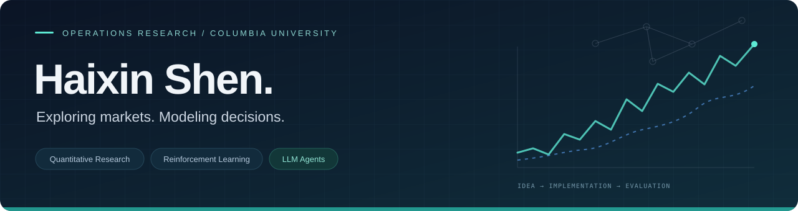

  

  <a href="https://github.com/Terrence581/Quant-research"><b>Quant Research</b></a>
  &nbsp; · &nbsp;
  <a href="https://github.com/Terrence581/Reinforcement-Learning"><b>Reinforcement Learning</b></a>
  &nbsp; · &nbsp;
  <a href="https://github.com/Terrence581/Quant-research/tree/main/LLM%20Agent%E6%9E%B6%E6%9E%84"><b>LLM Agents</b></a>

## Hi, I'm Haixin 👋

I'm pursuing an **MS in Operations Research at Columbia University in NYC**. I'm interested in understanding the underlying problems and fundamental principles that data reveal, and in applying theory to the real world.

My public work spans **A-share factor research**, **bandit policies**, and **architecture designs for LLM-assisted factor discovery**.

## Selected work

<table>
<tr>
<td width="50%" valign="top">

### 01 / Quantitative Research

**A-share factors & backtesting**

Cross-sectional momentum, trend strategies, QTrend20, and financial growth factors. Includes portfolio backtests, IC / RankIC analysis, and diagnostic plots.

`Python` `Factor Research` `Backtesting`

**[Explore the research →](https://github.com/Terrence581/Quant-research)**

</td>
<td width="50%" valign="top">

### 02 / Reinforcement Learning

**Bandits & sequential decisions**

Two- and three-state Whittle index implementations, myopic and finite-horizon policies, and simulation notebooks for policy comparison.

`Python` `Jupyter` `Bandit Policies`

**[Explore the experiments →](https://github.com/Terrence581/Reinforcement-Learning)**

</td>
</tr>
</table>

### 03 / LLM-assisted Factor Discovery

Architecture documents exploring how LLM agents can support A-share factor research, with both a full design and a streamlined execution plan.

**[Read the architecture →](https://github.com/Terrence581/Quant-research/tree/main/LLM%20Agent%E6%9E%B6%E6%9E%84)**

## Research map

| Area | Topics in my repositories |
| :--- | :--- |
| **Markets** | Cross-sectional momentum · Price-path smoothness · Financial growth factors |
| **Evaluation** | Grouped portfolios · Long–short returns · IC / RankIC · Drawdown diagnostics |
| **Decisions** | Multi-armed bandits · Whittle indices · Policy simulation |
| **Agents** | LLM-assisted factor discovery · Research workflow design |

---

  Python &nbsp; / &nbsp; Jupyter &nbsp; / &nbsp; Quantitative Research &nbsp; / &nbsp; Sequential Decisions

